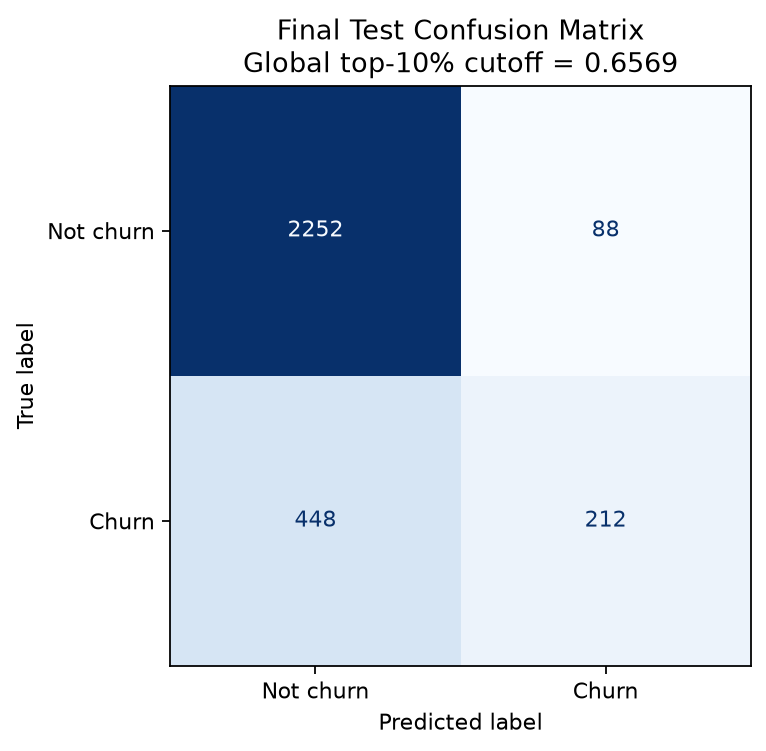
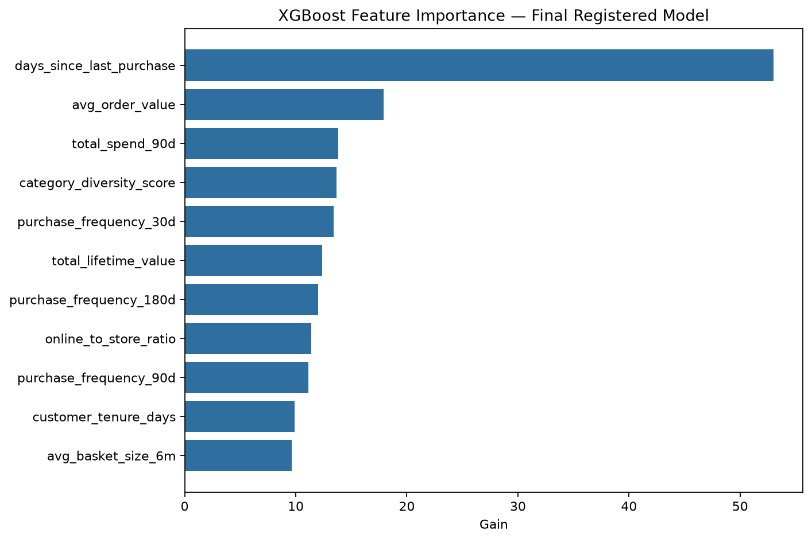

# Lab 3 Churn Model Evaluation Report

## Evaluation setup

I trained the final model locally with XGBoost 3.2.0 using data queried from the SageMaker Feature Store offline store through Athena. The dataset contained 9,999 customers with a 22.0% churn rate. I used a stratified 70/30 split with seed 42: 6,999 customers for final training and an untouched 3,000-customer test set for the graded evaluation. The model targets the 10% of customers with the highest predicted churn probabilities, representing a fixed outreach budget of 300 test customers.

The final configuration was `max_depth=6`, `min_child_weight=10`, `subsample=0.6`, `colsample_bytree=1.0`, `eta=0.1`, and 35 boosting rounds. The final run is recorded in MLflow as `19c1bc4e633243329546e03bfe2f4641` and was registered as version 1 of `northstar-churn-models` with `PendingManualApproval` status.

## Validation and model selection

I evaluated 81 configurations from the Cartesian product of three values each for `max_depth`, `min_child_weight`, `subsample`, and `colsample_bytree`. Every run used the same 56/14/30 train/validation/test partition. The 30% test set was held aside first, and the remaining 70% development set was split 80/20; 80% of 70% is 56% for training, while 20% of 70% is 14% for validation. Every run also used `eta=0.1`, at most 200 boosting rounds, early stopping, an automatically calculated class weight, and seed 42. All 81 configurations were logged to MLflow, and the test set remained untouched throughout tuning.

My initial selection rule chose the gate-passing configuration with the highest validation AUC. After examining what the metrics represented, I revised the rule before evaluating the test set. Because the business can contact only the top 10% of customers, I selected the gate-passing model that captured the greatest number of validation churners in that fixed-size group; validation AUC broke a tie. This avoids treating a small improvement in global ranking as more important than identifying additional churners within the actual outreach budget.

The selected configuration was tuning run 48. On the 1,400-customer validation set, it captured 103 of 308 churners among the 140 selected customers, giving 0.7357 precision, 0.3344 recall, and 0.7782 AUC. I then locked its configuration, retrained it on the full 70% development set for 35 rounds, and evaluated the held-out test set once.

## Final test results

| Metric | Test result | Requirement | Status |
|---|---:|---:|---|
| AUC-ROC | 0.7785 | Report; no fixed threshold | Reported |
| Precision at top 10% | 0.7067 | At least 0.50 | Pass |
| Recall at top 10% | 0.3212 | At least 0.25 | Pass |
| Recency-only baseline AUC | 0.7233 | Report | Reported |
| AUC lift over baseline | +0.0552 | 95% CI excludes zero | Pass |
| Lift 95% confidence interval | [0.0354, 0.0727] | Excludes zero | Pass |

The full model's AUC exceeded the recency-only baseline by 0.0552. The paired bootstrap confidence interval is entirely above zero, providing evidence that the full feature set adds predictive signal beyond `days_since_last_purchase` alone.

At the global probability cutoff of 0.6569, the model selected exactly 300 customers. It identified 212 churners correctly, selected 88 non-churners, missed 448 churners, and correctly excluded 2,252 non-churners. Thus, 70.7% of contacted customers were churners, and the outreach list captured 32.1% of all test-set churners.

## Feature importance

The five most important features by XGBoost gain were:

1. `days_since_last_purchase`
2. `avg_order_value`
3. `total_spend_90d`
4. `category_diversity_score`
5. `purchase_frequency_30d`

These are commercially plausible signals. A long interval since the last purchase is a direct indication of disengagement, while order value, recent spending, category breadth, and purchase frequency describe the strength and breadth of a customer's purchasing relationship. Intuitively, customers buying fewer or less expensive items at a lower rate may be more likely to churn. Gain importance establishes that these features contributed to tree decisions, but it does not by itself establish the direction of each relationship or a causal effect; the directional interpretation is a business hypothesis consistent with the observed feature ranking.

## Loyalty-tier slices

| Tier | Test n | Positives | AUC | Recall at global top-10% cutoff | Too small to conclude? |
|---|---:|---:|---:|---:|---|
| Bronze | 1,071 | 361 | 0.7568 | 0.4349 | No |
| Gold | 483 | 52 | 0.7449 | 0.1346 | No |
| Platinum | 307 | 21 | 0.8693 | 0.0952 | No |
| Silver | 1,139 | 226 | 0.7050 | 0.2035 | No |

No tier met the predefined too-small rule of fewer than 20 positives or fewer than 20 negatives. Platinum, however, contained only 21 positives, so its result is just above the cutoff and should still be interpreted cautiously.

Platinum was the weakest tier by recall: the global threshold captured only 2 of its 21 churners, or 9.5%. This is operationally important because Platinum customers are highly valuable. At the same time, Platinum had the strongest within-tier AUC at 0.8693. Those results are not contradictory: the model ranks Platinum churners well relative to other Platinum customers, but their predicted probabilities do not often clear a global threshold dominated by higher-scored customers from other tiers. Bronze received the greatest coverage, with 43.5% recall.

For a production system, I would evaluate a value-weighted targeting objective and tier-aware thresholds or a minimum Platinum allocation. That would align the contact budget with expected retained customer value rather than treating every captured churner as equally valuable.

The complete per-tier results are available in [the slice evaluation CSV](lab3-evidence/slice-evaluation.csv).
